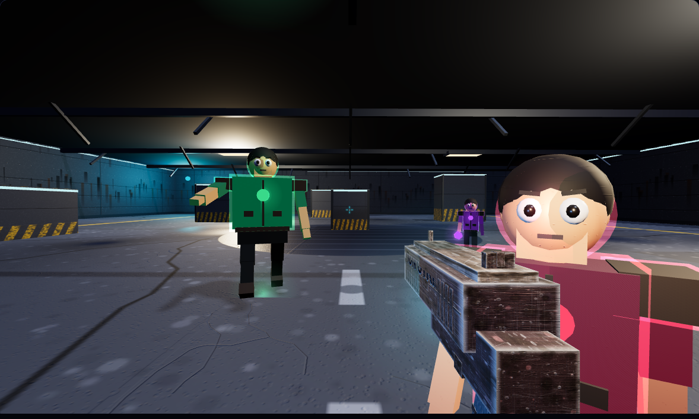
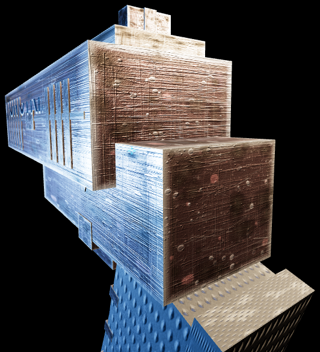
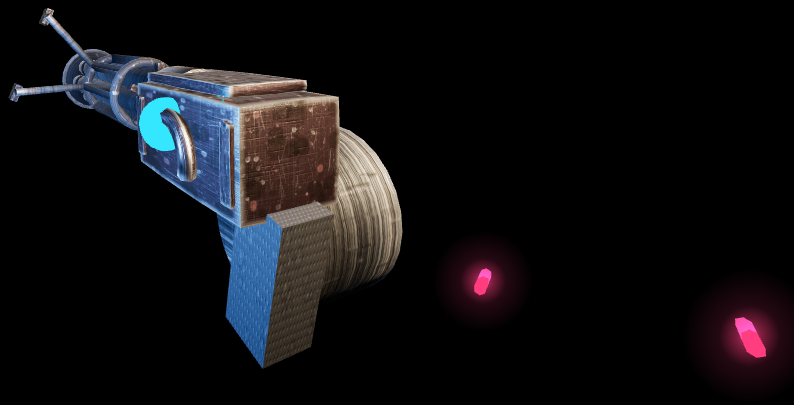
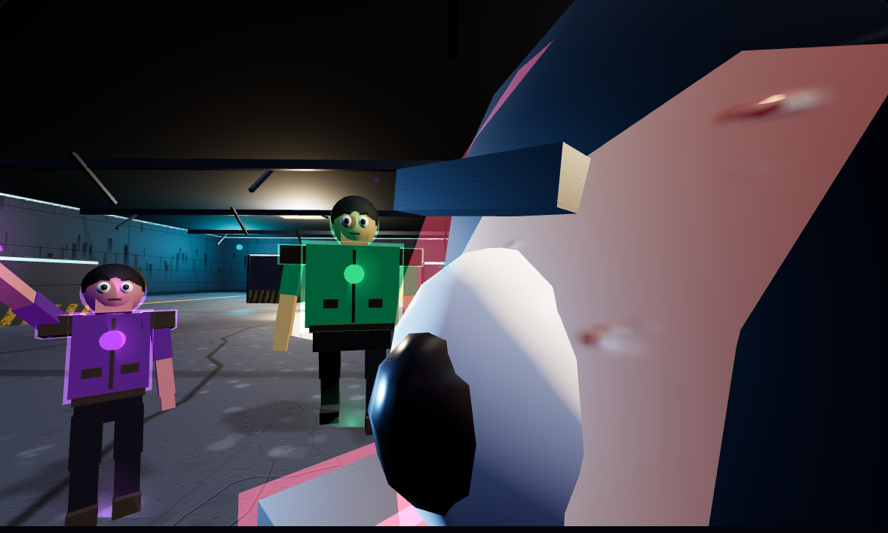
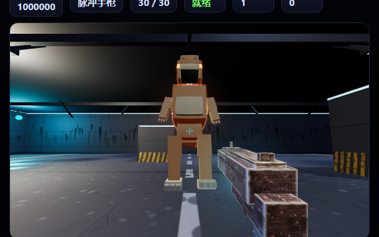

# 霓虹突击 · NEON STRIKE

第一人称射击游戏（FPS）。原生 **HTML + CSS + JavaScript + Three.js**，单页应用，**双击 `index.html` 即可玩** —— 不需要服务器、不需要联网。



## 运行

直接双击 `index.html`。浏览器会请求锁定鼠标（Pointer Lock），这是第一人称视角的前提：

- **点击画面** → 锁定鼠标，进入游戏
- **Esc** → 解除锁定，游戏自动暂停

> 若浏览器阻止了指针锁定，可用 `chrome://settings/content/pointerLock` 放行；或在页面里用方向键 + 鼠标右键平移视角（部分浏览器支持）。

## 视角控制（两种模式自动切换）

| 模式 | 触发条件 | 操作 |
| --- | --- | --- |
| **鼠标锁定** | 浏览器允许 Pointer Lock（点击画面后） | 移动鼠标直接转头，和原生 FPS 一致 |
| **自由鼠标** | 指针锁定被拒（Esc 冷却、浏览器策略、iframe 嵌入等） | **移动鼠标**即转头，手感与锁定模式完全一致 |

两种模式都采用**相对位移**（鼠标移动多少，视角转多少）——**鼠标停下，视角就停下**，不会自己漂移或慢慢抬头。

自由模式额外处理了窗口边缘：把鼠标推到窗口边缘会**持续朝该方向转身**，避免转到一半卡住；把鼠标移回窗口内即停止。

页面底部会显示当前处于哪种模式（绿色=已锁定，黄色=自由模式）。

> 锁定模式若因 `Esc` 退出而被浏览器冷却拒绝，约 1 秒后再点一次画面即可锁定；失败会自动降级到自由模式而不是卡住不动。

> 枪口上跳会被**自动回收**：连射时准星会上抬，但停火后视角会自动回正，不会越打越高。

## 操作

| 操作 | 作用 |
| --- | --- |
| 移动鼠标 / 移离画面中心 | 转头瞄准 |
| `WASD` / `方向键` | 移动 |
| 鼠标左键 | 射击（按住连发） |
| `1` / `2` / `Q` / 滚轮 | 切换武器（脉冲手枪 / 加特林） |
| `Shift` | 冲刺（视野会略微收窄） |
| `空格` | 跳跃 |
| `R` | 换弹（弹匣打空会自动换弹） |
| `Esc` | 暂停 / 解除鼠标锁定 |
| `M` | 静音 |

## 武器

| 武器 | 伤害 | 射速 | 弹匣 | 换弹 | 特点 |
| --- | --- | --- | --- | --- | --- |
| 脉冲手枪 | 26 | 0.11s | 30 | 1.35s | 单发精准，爆头双倍 |
| 加特林 | 13 | **0.042s** | **220** | 2.7s | 六管旋转、极高射速；**散布随连射扩大**，停火后回落 |

**切换武器：`1` / `2` / `Q` / 鼠标滚轮**，HUD 顶部显示当前武器名与弹药。

加特林有独立的**枪管惯性旋转**（开火时加速、停火后减速）和更轻的单发后坐（但累积更快，因此要控制连射节奏）。

## 射击与命中是怎么算的

### 玩家开枪：**瞬发射线（hitscan）+ 散布锥**

开火时（`tryFire()`）不是生成一颗飞行的子弹，而是直接从相机中心打一条**射线**，一步到位算出命中点：

1. **散布锥**：把相机正前方方向在一个圆锥角内随机偏开。锥角 = `武器基础散布 + 连射升温`。
   - 圆盘内取点用 `sqrt(random())`，保证弹着在圆盘上**密度均匀**（直接用 `random()` 会往中心堆）。
   - 锥角单位是**弧度**。手枪 0.012 rad（0.69°），加特林 0.030 rad（1.72°）。
2. **求交**：`raycaster.intersectObjects(hitTargets + 掩体)`，取最近的一个交点。
3. **判定**：交点属于敌人的躯干/头 → 扣血；头额外 ×2 伤害（爆头）；属于掩体 → 只出火花，**不造成伤害**。
4. **曳光**：从枪口 `localToWorld` 到命中点画一根发光的圆柱（`spawnTracer`），所以曳光真的"从枪管射向弹着点"。

### 敌人的命中：**真的在飞行的弹丸**

敌人不用射线，而是生成实体弹丸，每帧推进，所以玩家**能看见、也能躲**：

| | 射击 `fireBullets` | 投掷 `throwObject` |
| --- | --- | --- |
| 弹道 | 水平直线，`vy = 0` | 抛物线，`vy` 受重力 16 修正 |
| 判定 | 每帧和玩家做圆形距离检测 | 落地或贴身 → **范围爆炸** |
| 掩体 | 会被柱子挡下 | 也会撞柱子在柱边爆 |
| 命中反馈 | 粉红火花 + 扣血 | 橙黄冲击环 + 范围伤害 |

投掷物的初速是**解出来的**：先算从敌人到玩家的时间 `t = 距离 / 速度`，再由 `vy = (目标高度差)/t + 0.5·g·t` 反推初速，所以它能正好落到玩家脚下 —— 会往掩体后面躲的玩家不会被炸到。

### 四个曾经存在、现已修掉的 bug

**1. 玩家的子弹会穿墙。**
射线只测了 `hitTargets`（敌人躯干 + 头），**没测掩体**。结果是敌人的子弹会被柱子挡下，玩家的子弹却能穿过柱子打死柱子后面的敌人 —— 双方规则不一致，掩体完全没意义。
现在把掩体柱的实体一起加入求交列表，交点落在柱子上就只出火花。实测：同一敌人放在掩体后 → 伤害 0；挪到无遮挡处 → 正常命中。

**2. 散布算了却从没用上。**
`const spread = w.spread + player.spreadHeat;` 这行**算完就扔了**，射线永远精确指向屏幕正中那一个点。加特林连射时每发都精确命中同一点，射起来毫无技术含量。
现在把射线方向真正偏开。实测：连打 12 发（每发重新瞄准）总伤害 78，而理论满打满算是 156 —— 有 6 发打空了。

**3. 连射升温机制是失效的。**
升温的衰减是固定 `0.55/秒`，而加特林每秒才攒 `0.072` —— **衰减比累积还快**，所以"连射散布扩大"永远攒不起来。
改成**比例衰减**（`spreadHeat -= dt · spreadHeat · 0.8`，半衰期约 0.87 秒），并把每发增量提到 `heat × 0.020`：

| 武器 | 每发增量 | 平衡点 | 吃满上限 | 最终锥角 |
| --- | --- | --- | --- | --- |
| 手枪 | +0.002 | 0.0225 rad | 约 1.5 秒 | 0.018 rad ≈ 1.03° |
| 加特林 | +0.006 | 0.15 rad | 约 0.6 秒（11 发） | 0.054 rad ≈ 3.09° |

实测曲线（加特林连射 3 秒 → 停火 3 秒）：`0 → 0.054（上限）→ 0.0047`，涨得快、收得稳。

**4. 波次横幅只存在、不显示。**
`banner = { title, sub, t }` 在 `startWave()` 里创建，主循环每帧倒计时，但**没有任何 DOM 元素画它** —— 所以"第 N 波"和"警告：首领单位来袭"其实一直没出现在屏幕上。
现在 `#stage` 里加了 `#waveBanner`，`updateHUD` 按剩余时间淡出显示；巨兽出现时横幅会写"警告：巨兽出没"。

### 命中体（hitbox）怎么设计的

敌人是**程序化拼装的人形**（躯干 + 头 + 四肢），但只有两个网格参与射线检测：

- `hm.torso` —— 躯干，命中正常伤害；
- `hm.head` —— 头，`userData.headshot = true`，伤害 ×2。

四肢不参与判定 —— 否则贴着掩体探头的敌人会被"隔墙打手"，体验很差。敌人死亡时把这两个网格从 `hitTargets` 里摘掉，避免尸体继续吃子弹。
巨兽同理：命中体是它的**躯干和头**，腿、尾、背板不参与判定（打尾不算爆头，也不影响它前进）。

## 敌人的远程攻击

敌人有两类远程攻击，**都会用**，威胁方式完全不同：

| 类型 | 行为 | 特征 |
| --- | --- | --- |
| **射击** | 高速直线弹丸 | 弹道平直、速度 16，能被掩体挡下，需要预判提前量 |
| **投掷** | 抛物线飞行的能量块 | 受重力影响会先升起再落下，**落地后范围爆炸**（有扩散的冲击环），站在落点会被范围伤害 |
| **原子吐息**（巨兽） | 从嘴里沿直线射出的蓝色能量束 | 先吼一声蓄能 0.85 秒（嘴里亮起能量球），然后发射；速度 26，**会被掩体挡下**，命中 26 伤害 |

- **射手**：两连发弹丸 + 定时投掷紫色爆炸块
- **重装兵**：近战为主，同时会抛掷重型迫击弹（范围大、伤害高）
- **首领**：环形弹幕 + 瞄准散射 + 燃烧弹投掷
- **巨兽**：中距离（4.5~20 m）吐息，贴身撕咬（32 伤害 + 把人撞飞），贴近时**尾巴横扫**（14 伤害 + 强击退）

投掷时敌人的手臂会**高举再甩出**（与近战挥击是不同的动作），能看出它要扔。

- 敌人一波比一波多、越来越强，清空一波进入下一波，**每 5 波出现首领**（环形弹幕 + 召唤小怪 + 瞄准散射 + 燃烧弹投掷）；从第 3 波起每波都有巨兽（第 8 波 2 头，第 12 波 3 头）
- **人形敌人**程序化生成：头（带发光面罩）、躯干（胸口能量核心）、双臂、双腿、肩甲、髋部，各类型体型不同（重装兵宽厚、首领巨大）
- **巨兽（哥斯拉型）**同样只用基本体拼装：四足 + 逐段枢轴的长尾 + 六块背板 + 吻部与可张开下颌 + 两排牙齿 + 发光眼睛 + 短前肢带爪；高约 **5.1 m**、长约 **5.0 m**，血 340（比重装兵高近一倍）
- 敌人有**行走动画**：人形腿臂交替 + 身体起伏；巨兽四足交替、**尾巴逐段摆动**（越靠尾尖摆幅越大，背板挂在尾巴枢轴上所以跟着走）、撕咬时下颌张开
- 敌人类型：冲锋兵（直线冲锋）、射手（保持距离还击，手心凝聚能量球）、重装兵（高血高伤）、巨兽（高血 + 吐息 + 撕咬 + 尾扫）、首领
- **疾行者（黄色高速突进）已取消**：`runner` 类型、它的折线突进 AI 和前倾冲刺动画全部删除，那一档压力改由更多冲锋兵 + 巨兽承担
- **爆头判定**：躯干和头是两个独立命中体，打中头部造成 **2 倍伤害**，命中标记变粉
- 场地里的发光箱体是掩体：**子弹会被挡住**，敌人会绕行
- 掉落物：绿色 `+` 加血、黄色 `A` 补弹、青色 `R` 九秒连射
- 连续击杀有加成倍率（最高 3 倍）

## 美术：程序化 PBR 贴图

**没有任何外部图片文件** —— 所有材质都是用 canvas 现场生成的三通道 PBR 贴图（albedo + 法线 + 粗糙度）：

| 材质 | 生成方式 |
| --- | --- |
| 皮肤 | 多倍频噪声 + 毛孔高频细节 → 法线贴出细微起伏 |
| 夹克 / 裤子 | 织物斜纹（正弦交织）+ 绒毛噪声，粗糙度 0.86~0.9 |
| 枪械金属 | 拉丝纹（横向拉伸的噪声）+ 麻点，metalness 0.92 |
| 聚合物握把 | 网格状颗粒纹 + 细噪声，粗糙度 0.74 |
| 头发 / 皮革 | 纤维条纹 / 颗粒纹 |
| **巨兽鳞甲** | 错排六边形鳞板（`cells` 可调密度）+ 鳞板之间的沟缝：缝更暗、更粗糙，法线贴出鳞片起伏 |
| **巨兽腹板 / 背板** | 浅色皮肤纹理 / 骨板颗粒纹 |
| **混凝土地面** | 大幅 canvas 绘制：骨料 / 污渍 / 油污 / 裂缝 / 磨损标线 / 水洼 / 排水格栅 |
| **金属墙板** | 压筋 / 拼缝 / 铆钉 / 划痕 / 锈迹流痕 |
| **警示条** | 黄黑斜纹 + 磨损剥落 |
| **磨损枪械** | 拉丝底 + 划痕露白 + 边缘掉漆 + 积碳油污 |

**环境贴图**：用 PMREMGenerator 从一张程序化的等距柱状"影棚"贴图生成 IBL —— 金属没有可反射的环境就不像金属，这是拟真感的关键。

## 武器贴图：如何把程序化金属做成"照片"

真实枪械特写和"塑料玩具"的差别，几乎全在**贴图的微观层次**上。本项目的金属贴图由 `makeGunMetalMaps()` 一次性生成三张贴图（albedo / normal / roughness），逐像素叠加了下面这些层：

| 层 | 做法 | 视觉收益 |
| --- | --- | --- |
| 表面处理不均 | 低频 fbm（发蓝褪色、磷化厚薄） | 大块的深浅变化，金属不再是均匀色块 |
| 车削刀纹 | 高频拉伸噪声（横向平行细线） | 加工感，一眼能看出是机加工件 |
| 麻点 / 氧化点 | 中频噪声 + 极少数极暗像素 | 微观凹陷，边缘有真实的暗点 |
| **微观颗粒** | 整数哈希白噪（两级粒径） | 照片感的关键 —— 真实金属在任何尺度上都有像素级抖动 |
| 油泥 / 手汗 | 低频暖褐污渍，同时抬高粗糙度 | 手握过的痕迹，脏但有层次 |
| **油膜干涉（彩虹）** | 低频斑块 + 色相环，粗糙度反而变低 | 薄油膜的彩色反光，塑料做不到 |
| 热变色 / 氧化 | 极低频紫蓝色偏 | 长期使用的老化感 |
| **边缘磨损带** | 用贴图边框当几何边缘（BoxGeometry 每面 UV 都是 0~1），画一圈磨白 | 每个棱角都被磨出亮白钢边 |
| **边缘积垢暗带** | 磨白边内侧再压一圈暗色、更粗糙 | 真实金属是"亮线 + 暗垢"成对出现 |
| 深划痕 | 260 条随机划痕，62% 露亮钢、其余是暗沟 | 划痕有亮沟底 + 两侧暗微倒角 |
| 抛光旋纹 | 40 段圆弧（被反复摩挲的痕迹） | 手感与年代感 |
| 崩口 / 掉漆 | 40 个不规则小坑 + 一圈亮毛刺 | 磕碰痕迹 |
| 积碳 / 油泥斑 | 30 处径向渐变（albedo 变暗、粗糙度变高） | 凹处堆积的脏东西 |

**每种零件单独一套表面处理**（`GUN_FINISH`）：发蓝钢 / 磷化钢 / 不锈钢 / 发黑，各自有独立的底色、磨白色和金属度；套筒顶部因为长期插在枪套里，额外做了"提亮 + 积灰"处理。

**握把**是另一套贴图：菱形颗粒纹（真实枪械握把最标志性的表面处理）+ 沙粒 / 纤维噪声。

### 车削件专用贴图：为什么加特林之前"塑料感"很重

加特林枪上最显眼的零件是**枪管、散热套筒和弹鼓**，它们全是圆柱体。圆柱体的 UV 是**绕圆周包裹**的（u 从 0 绕一圈回到 1），直接套用普通金属贴图会出两个致命问题：

1. **假接缝** —— 贴图边框那条"边缘磨损带"会绕着枪管转一圈，看起来像把一根管子接成了两截；
2. **颗粒被拉成条纹** —— 圆周只有 0.16 m，一张 256 px 的贴图摊上去，每个像素被拉长好几倍，金属颗粒变成一道道竖条纹。

所以圆柱件换用独立的 `makeTubeMaps()`（256 × 512，**x = 圆周、y = 轴向**），规则和普通贴图完全不同：

| 关键处理 | 做法 | 解决什么 |
| --- | --- | --- |
| **轴向无缝** | 所有连续项只依赖轴向 v；周向不均一律用 `sin(2πu)` 这类**周期函数** | 绕一圈回来能接上，没有竖直缝线 |
| **车削横纹** | 420 条**水平**细线（圆周上的车痕在贴图里就是一整条横线），其中 9 条是更深的粗车刀痕 | 这是"车削金属"最强的视觉线索，噪声做不出来 |
| **轴向划痕** | 110 条竖直长痕，带亮沟底 + 两侧暗微倒角 | 管子被蹭出来的使用痕迹 |
| **膛口磨亮带** | 枪口一段渐变到抛光亮钢（枪口磨损最重的地方） | 前后状态有明确区分 |
| **膛口热变色** | 7 条水平色带（稻草黄 → 紫 → 蓝），真实的氧化环 | 打过火的中段枪管最有辨识度的细节 |
| **尾端积碳** | 顶部渐变到深黑，粗糙度骤升 | 靠近机匣处最脏 |

接缝的验证方式是直接比对贴图首列与末列的像素差 —— 实测 **接缝差 ≈ 内部相邻列的噪声水平**（9.3 vs 11.5），即接缝在视觉上不可见。

另外三处结构性的修改同样关键：

- **散热套筒改成"笼式"** —— 原来是一个整圆的开口圆筒，把六根枪管**全挡在里面**，贴图做得再好也看不见。改成一圈实心环 + 8 根纵向支柱，枪管从支柱之间露出来（真实加特林就是这个样子），同时补上了枪管口箍、消焰器喇叭口、轮毂蛛爪。
- **机匣做圆角倒棱**（`roundedBox()`）—— 立方体的 12 条棱是数学锐边，渲染里只有一条硬边高光，看着像塑料。真实金属件的棱有倒角，边缘会出现一条渐变的高光带，**这条带子才是金属感的主要来源**。
- **逐面打散 UV**（`offsetBoxFaces()`）—— BoxGeometry 每个面的 UV 都是 0~1，同一个 Box 上 6 个面会贴**一模一样**的图，近看就是明显的复制粘贴。现在每个面单独做旋转 + 镜像，磨损带落在各自不同的边上（注意只旋转不做平移：平移会让 UV 越过 0/1，在 RepeatWrapping 下把边框亮带复制到面的中间）。

### 贴图细节的量化验证

"看起来真实"不能靠感觉。用**局部对比度**（相邻像素差的均值）可以客观衡量一张贴图到底有没有表面结构：

| 贴图 | 局部对比度（改之前） | 改之后 |
| --- | --- | --- |
| `gunTube` 枪管 | 1.5 | **9.3** |
| `gunShroud` 散热套筒 | 1.5 | **9.7** |
| `gunDrum` 弹鼓 | 1.5 | **10.5** |
| `gunFrame` 机匣 | 1.3 | **2.8** |
| `gunSlide` 套筒 | 1.4 | **3.7** |

> 通用金属贴图（`makeGunMetalMaps`）也补上了**显式绘制的加工纹**：520 条有方向的平行磨痕 + 磷化/发黑件特有的 900 处皱皮颗粒。之前这些只靠 fbm，强度太弱，在屏幕上会被 mipmap 抹平，表现为"一整块没有细节的灰"。

**激光刻字**（`NEON STRIKE`、`9×19 · P-9`、`ROTARY Mk-IV`、`7.62 × 51`）是贴在零件侧面的一层薄面片贴花，用 `polygonOffset` + `renderOrder` 避免 z-fighting。

> **刻字贴花的朝向**：文字纹理是画在 `PlaneGeometry` 的**局部 X 轴**上的，而枪械长轴是 **Z 轴** —— 所以贴花必须绕 Y 转 90°，法线才指向 ±X（机匣侧面）、文字才顺着枪管排布。
>
> 直接用 `rotation.y = 0` 会同时出两个问题：文字**横跨枪身**（看着像"横过来的文字"），而且贴花宽度 0.26~0.30 m 远大于枪身宽度 0.15~0.20 m，整块贴花会从侧面戳出来变成一片"鳍"。
>
> 两面都用同一个绕向（右侧 +90°、左侧 −90°），从各自一侧看文字都是正的 —— 自检方式是把贴花的"文字前进方向"变换到世界坐标，和该侧观看者的屏幕右方做点积，四个贴花实测均为 **dot = 1.0**。

### 枪械专用"影棚"环境贴图

世界的环境贴图是暗蓝工业风，套在枪上只会反射出一团糊。真实枪械特写里，金属面上永远是**几道清晰的长条高光**（顶灯灯管 + 侧向柔光箱）。所以给枪械单独做了一张 512×256 的等距柱状"影棚"贴图（7 条顶部灯管 + 左右两块柔光箱 + 远处霓虹反光），PMREM 之后作为 `envMap` 挂在所有枪械材质上，`envMapIntensity` 再乘 1.25。

效果对比（同一机位、同一姿态，只改环境贴图）：

| 指标 | 改之前 | 改之后 |
| --- | --- | --- |
| 枪体颜色桶数 | 976 | **1175** |
| 水平局部梯度 | 10.2 | **13.5** |
| 垂直局部梯度 | 11.2 | **16.4** |
| 亮像素占比 | 12.6% | **17.4%** |
| 亮度级 | 16/16 | 16/16 |

### 视图模型补光（只照手里的枪）

真实 FPS 都会单独给武器打光，否则在暗场景里枪只剩一个剪影。项目里挂了**两盏随身灯**（暖色主光 + 冷色勾边光）到相机上，并用 three.js 的 **layers 隔离**：灯只在图层 1、视图模型同时在图层 0 和 1、相机 `layers.enable(1)`。这样补光只落在手里的枪上，**不会在地上拖出一圈假的光斑**。





## 装配体：消灭"悬空零件"和"错位贴图"

贴图做得再好，零件本身是散的，画面一样假。手枪模型里曾经同时存在三种毛病，而且都是**坐标写错**造成的，肉眼只会觉得"哪里怪怪的"：

| 毛病 | 具体表现 | 根因 |
| --- | --- | --- |
| **子物体用了枪械坐标** | 抛壳口浮在套筒上方 2cm；照门缺口飞到照门上方 11cm；弹匣见证孔掉到弹匣下方 32cm | 这些零件是 `slide` / `mag` 的**子物体**，位置却按枪械坐标写。父物体已经把它挪到自己的位置上了，再按枪械坐标一写，位置就翻倍 |
| **二次旋转** | 握把的背板 / 前板 / 弹匣井 / 手指槽全部歪掉，看着像几块贴歪的板 | 握把自身已经转了 `rotation.x = 0.30`，子物体**继承**这个旋转；子物体再写一次 `rotation.x = 0.30`，世界角度就成了 `0.60 rad` |
| **细节件比宿主还宽** | 防滑纹浮在套筒外 7.5mm；能量电池有 3.7cm 整颗悬在枪外 | 细节件的 X 中心 + 半宽超过宿主的半宽 |

统一的三条规矩：

1. **子物体的 `position` 一律用父物体局部坐标**，想放枪械坐标就先算差值；
2. **子物体的 `rotation` 只写相对差值**（父物体已经转过的部分不要再写）；
3. **所有侧面细节的外表面只比宿主外凸 1~2mm**，宁可几乎贴平，也不要浮在外面。

加特林那边也修了三处：

- **枪管束整个浮在机匣前面 17cm** —— `cluster` 整体偏移 `-0.44`，而枪管自身又偏移 `-0.35`，两层一叠加，枪管后端停在 z = -0.39，机匣前端在 z = -0.22，中间空了 17cm。现在 `cluster` 归零，所有零件直接用枪械局部 z 排布，枪管后端**插进机匣里 7cm**；
- **散热套筒的"环"其实是实心圆盘** —— `CylinderGeometry` 默认带端盖，两片 23.6cm 直径的实心盘把六根枪管挡得死死的。改用 `TorusGeometry`（中间有孔），并且把笼子的半径从 0.118 收到 0.088 —— 内侧正好贴住枪管束外径 0.086；
- **消焰器整体高出枪管轴线 3.5cm** —— `shroud` 和 `brake` 多给了 `y = 0.035`，喇叭口浮在枪管正上方。现在和枪管同心，枪口闪光也从枪管中间的 z = -0.92 移到消焰器口的 z = -1.02。

### 怎么客观验证"没有悬空零件"

肉眼判断不可靠，这里用了两种可以量化的办法：

**1. 装配体连通性（几何层面）**
把枪上每个网格的世界 AABB 两两求交，用「相交体积 > 0」当接触判据，再用并查集求连通分量。**任何单独的分量就是一截没装上去的零件**。

| 枪 | 网格数 | 连通分量 | 结果 |
| --- | --- | --- | --- |
| 手枪 | 68 | 主体 65 + 3 个贴花面片 | PASS |
| 加特林 | 58 | 主体 56 + 2 个刻字面片 | PASS |

剩下的少数几个都是**零厚度的贴花面片**（刻字、准星红点），本来就该贴在表面而不是并进实体。

**2. 剪影连通块（像素层面）**
把整把枪的材质换成纯白不透明材质渲染一张"剪影图"，再对剪影做 4-邻接连通块标记 —— **任何悬空的零件都会在剪影里变成孤立的第二个色块**，比几何判据更严格（它连"看着贴在一起但其实有缝"都能抓出来）。

| 枪 | 枪体像素 | 最大连通块 | 结论 |
| --- | --- | --- | --- |
| 手枪 | 133 425 | **99.97 %** | PASS |
| 加特林 | 227 347 | **99.74 %** | PASS |

## 场景：工业厂房内部

场景不再是"露天的空旷平台"，而是一个**封闭的工业厂房**：

- **天花板** + 钢桁架（横梁 + 交错斜撑）+ 沿墙的粗管道 + 踢脚防撞条
- **天花灯具**：4 组灯具（发光面板 + 灯罩），其中 2 组是真实点光源 —— 点光源数量直接决定逐片元开销，其余靠发光面板和环境光撑亮度
- **地面**：大尺寸**不重复**混凝土贴图 —— 骨料颗粒、大块污渍与潮痕、油污、裂缝（凹陷）、磨损到露底的黄白地面标线、**水洼**（albedo 变暗 + 粗糙度骤降，会反射霓虹）、中央排水格栅
- **墙体**：金属压筋板 —— 横向压筋 + 竖向拼缝 + 铆钉 + 划痕 + 从上往下的锈迹/污渍流痕
- **掩体柱**：金属柱身 + **底部黄黑斜纹警示条**（随高度磨损）+ 柱角护条

地面法线贴图高频重复（6×）补足近处颗粒感，而 albedo 保持大图不重复 —— 这样既有整体布局的真实感，又有近看的细节。

## 武器：磨损金属

- **套筒防滑纹**（真实枪械最关键的辨识特征）、抛壳口、机匣散热槽
- **握把纹理面板**、底部导轨齿、弹匣底板、底把螺丝
- 加特林：**两脚支架**、弹鼓、散热套筒与散热孔
- 材质用**磨损金属贴图**：拉丝底纹 + 划痕露白 + 边缘掉漆 + 积碳油污（细节见上一节）



- **人物**：颅骨 + 下颌 + 头发（往后偏露出脸）、眼白/虹膜/瞳孔、眉毛、嘴、耳朵；夹克带拉链与口袋、腰带、肩甲；袖子/小臂/手、裤/靴分材质
- **武器**：手枪有套筒、枪管、消焰器、抛壳窗、扳机护圈、扳机、握把、弹匣、准星、底部导轨；加特林有六管转轮、散热套筒与散热孔、弹鼓、供弹槽、提把

材质细节靠 **PMREM 环境反射 + PCF 软阴影 + ACES 色调映射** 撑起来，霓虹元素（胸口核心、眼部微光、能量弹匣）作为点缀保留。

## 技术要点

- **射线命中判定**：从屏幕中心发射 `Raycaster`，命中敌人核心网格扣血，附带曳光弹道、命中标记与粒子飞溅
- **人形敌人**：全部由 Box / Sphere 拼装，关节用 Group 做枢轴实现行走循环；躯干与头分别注册为命中体以支持爆头
- **双模式视角**：指针锁定用相对位移，锁定不可用时同样用相对位移（外加窗口边缘持续转身），两种模式下相机朝向与玩家 yaw 严格同步
- **枪械视图模型**：第一人称视角下的枪是挂在相机上的子对象，含后坐力回弹、走路摆动、鼠标惯性偏移、枪口闪光与点光源
- **指针锁定视角**：`camera.rotation.order = 'YXZ'`，yaw/pitch 分离，pitch 夹在 ±1.45 弧度防止翻转
- **碰撞**：玩家是圆柱体，与箱体做 XZ 平面的圆-AABB 推出解算；敌人同样处理，并沿箱体切向绕行避免卡死
- **敌人 AI**：追击 / 保持距离射击 / 折线突进 / 冲锋，敌人之间互相分离避免重叠
- **程序化资源**：所有几何体与贴图均由代码生成，**没有任何模型或图片文件**；材质走完整 PBR（albedo/normal/roughness + IBL 环境反射）
- **敌人轮廓光**：放大一点的背面副本（BackSide + 加法混合），暗背景下轮廓依然清晰
- **性能**：ACES Filmic 色调映射、SRGB 色彩空间、PCF 软阴影（1536²）、点光源数量受控（逐片元成本）、纹理显存约 43 MB、加载约 2.1 s

## 改参数

全部在 `index.html` 内：

| 常量 | 含义 | 默认 |
| --- | --- | --- |
| `ARENA` | 场地半宽（实际是 56×56） | 28 |
| `WALK` / `SPRINT` | 步行 / 冲刺速度 | 6.4 / 10.6 |
| `EYE_H` / `JUMP_V` / `GRAVITY` | 视高 / 跳跃初速 / 重力 | 1.65 / 6.4 / 22 |
| `FIRE_CD` / `DMG` / `MAG` / `RELOAD` | 射速 / 伤害 / 弹匣 / 换弹时间 | 0.11 / 26 / 30 / 1.35 |
| `SENS` | 鼠标灵敏度 | 0.0022 |
| `WEAPONS` | 武器表（伤害/射速/弹匣/散布/后坐） | 见源码 |
| `ENEMY_TYPES` | 各敌人血量、速度、伤害、分数 | 见源码 |

## 调试钩子

页面暴露了 `window.__fps`，可在控制台查看或直接操纵运行时状态：

```js
__fps.state      // 'menu' | 'playing' | 'paused' | 'dead'
__fps.wave       // 当前波次
__fps.score      // 得分
__fps.kills      // 击杀数
__fps.enemies    // 敌人数组
__fps.player     // 玩家对象
__fps.draws      // 当前帧绘制调用数（看性能用）

__fps.begin()    // 直接开局（跳过指针锁定）
__fps.aimAt(x, y, z)  // 把视角对准某个坐标
__fps.fire()     // 手动开火
__fps.switchWeapon(i) // 切换武器
__fps.spawn(type, x, z) // 直接生成一个敌人（测试用）
__fps.projectiles // 敌方投射物数组（区分 kind: 'bullet' | 'thrown'）
__fps.projLog    // 每次投射物生成的日志（kind / 速度 / 时间），用于确定性测试
__fps.gameTime   // 游戏内累计时间（软件渲染下比墙钟慢，测试要按它等待）
__fps.hurt(50)   // 手动扣血

__fps.gunViews   // 两把枪的视图模型对象（Group）
__fps.mats       // 材质表（MAT.gunSlide / gunFrame / gunPoly …）
__fps.gunTextures // 枪械贴图源画布（albedo / normal / roughness），用于量化贴图细节
__fps.poseGun({x,y,z,rx,ry,rz,s}) // 定妆照：固定视图模型位姿与大小；传 null 恢复跟随游戏
__fps.renderer   // WebGLRenderer 实例
__fps.draws / __fps.tris / __fps.gameTime
```

> 定妆照配合"隔离渲染"（隐藏 `scene` 里除相机外的所有对象、`scene.background = null`、
> `renderer.setClearColor()` 换成中性底色）就能拍出干净的武器特写，用来肉眼/数值检查贴图细节。

## 文件

```
index.html          游戏本体（HTML + CSS + JS 全在这一个文件里）
vendor/three.min.js three.js r160 UMD 构建（654 KB，本地内置，离线可用）
preview.png         玩法预览截图
preview-character.png 人物与武器的近距离细节截图
preview-weapon.png  手枪特写（贴图细节）
preview-gatling.png 加特林特写（贴图细节）
preview-kaiju.png   巨兽的三视角几何投影（离线渲染，不是游戏截图）
kaiju-close.png     巨兽在游戏里的近距离截图（640×400，关闭阴影，SwiftShader 软件渲染）
kaiju-front.png     巨兽在掩体后的远景：被柱子挡住，只有头背露出来
kaiju-side.png      巨兽侧面站位截图
README.md           本文档

assemble-diag.js    离线几何校验：把 buildWeapon / makeKaiju 在 Node 里跑起来
runtime-test.js     离线运行时断言：命中判定、爆头、掩体、吐息、波次节奏
make-shot.js        生成 shot.html：把 __fps 调试钩子驱动的拍照脚本注入进 index.html
render-rotor.py     把导出的网格正交投影成图片，用来肉眼核对装配（Pillow）
render-kaiju.py     同上，针对巨兽
```

> `assemble-diag.js` 生成 `gatling-diag.js`（带 DOM stub 的无渲染版），跑它可以做三件事：
> **①** 转子转 90° 后逐网格对比世界坐标（验证"支架不转"）；**②** 用 AABB 相交体积做并查集，
> 确认零件没有悬空（巨兽 59 个网格 → 1 个连通分量）；**③** 把 AI 循环跑 3 波做冒烟测试。
> 这些脚本是开发时的校验工具，不影响游戏，删掉也能正常玩。

## 验证：先离线断言，再截图

用 headless 浏览器截图做验证太慢 —— 没有 GPU 时 Chrome 走 SwiftShader 软件渲染，
阴影图 1536² + 上千个网格，一张 1180×760 的截图要跑 3 分钟以上。**几何和逻辑不该靠截图验证。**

所以把验证分成两层：

| 层 | 工具 | 用时 | 验什么 |
| --- | --- | --- | --- |
| **几何 / 逻辑** | `runtime-test.js`（Node + 无渲染 stub） | ~1 秒 | 尺寸、装配连通性、命中/爆头/掩体、吐息与尾扫、波次节奏、模型是否跟随 AI 位置 |
| **像素** | headless Chrome + `make-shot.js` | 一张约 50 s（640×400、阴影关闭） | 模型在场景里确实存在、朝向、贴图观感 |

`node runtime-test.js && node runtime-diag.js` 现在 18 条断言全过：

```
巨兽模型：59 个网格 / 高 5.12 m / 长 5.02 m / 脚底 y = -0.016 / 连通分量 1
命中判定：躯干 10 发 260 伤害（满算 260）；头部 10 发 104，其中 2 发爆头 (52)
掩体：柱子正后方 6 m 的巨兽，10 发伤害 0（射线最近交点是掩体本身）
巨兽攻击：20 秒内原子吐息 4~5 次、贴身撕咬/尾扫共造成 500+ 伤害
吐息：10 m 无遮挡命中玩家 26 伤害；中间放一根柱子 → 0 伤害
散布：加特林吃满散布（0.054 rad ≈ 3.1°）打 14 m 外的冲锋兵，命中率 13%
波次：第 3 波起每波都有巨兽，第 8 波 2 头、第 12 波 3 头
模型跟随：模型世界坐标与 AI 坐标差 < 0.02 m
```



> 写断言时有一个坑值得记：`spawnEnemy` 之后**没有**调用 `updateMatrixWorld`，
> 直接 `Box3().setFromObject(enemy.hm.head)` 会拿到上一帧的旧矩阵，瞄准点算到原点附近，
> 于是"打躯干 0 伤害"——这是测试自己的 bug，不是游戏的 bug。

截图也有两种用法：
- **只读诊断**（约 20 s）：`chrome --headless=new --dump-dom shot.html`，把巨兽的 AABB、
  网格数、绘制调用数、以及"巨兽中心在屏幕上的投影坐标"写进一个 DOM 盒子，直接从 dump 的 HTML 里读。
  投影坐标 (0.00, 0.00) 意味着巨兽正好在准星后面 —— 不需要看图也能确认它存在。
- **定妆照**：`make-shot.js iso lite` 隐藏场景里除巨兽之外的所有对象并关闭阴影，
  只渲染巨兽本身。

> 之所以用 three.js 的 **UMD** 构建而不是官方推荐的 ES Module：ES Module 在 `file://` 协议下会被 CORS 拦截（`origin 'null'`），双击打开必然白屏。UMD 是传统 `<script src>`，不受同源限制，所以才能做到双击即玩。
